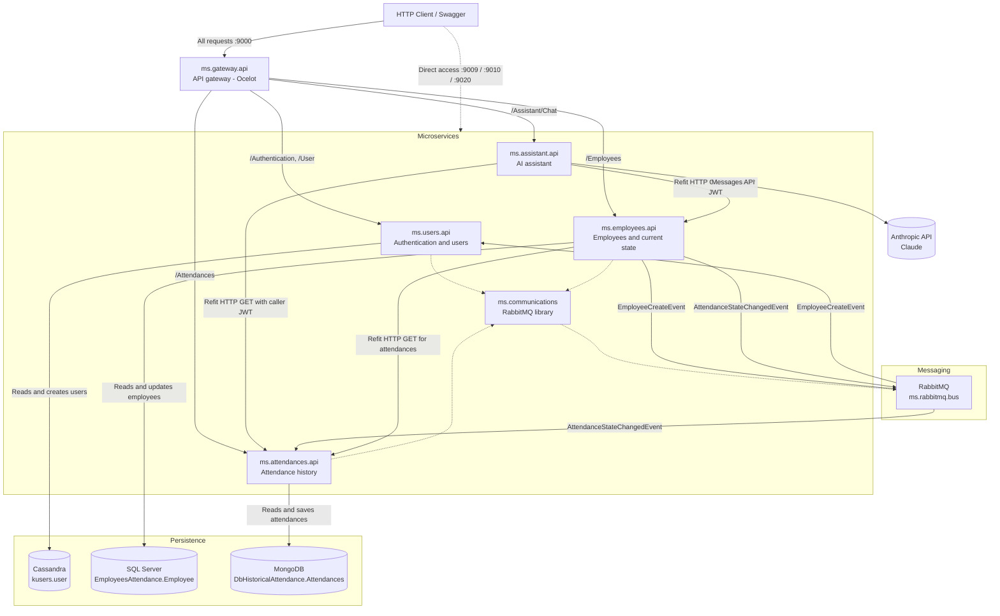
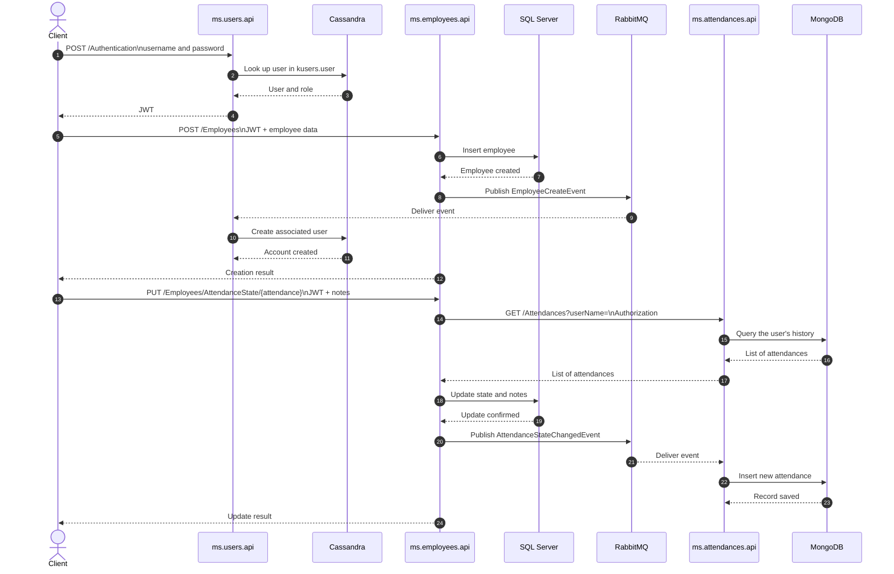

# EmployeeAttendanceControl

Distributed system for managing employees, users, and historical attendance records.

## General architecture

The project is organized as a .NET 10 microservices solution. Each service has its own responsibilities and storage, while RabbitMQ propagates events between them.

### Components

- **ms.gateway**: API gateway (Ocelot). The single entry point for clients: it forwards each request to the service that handles it, after checking the JWT and, for admin-only operations, the `admin` role. It has no persistence.
- **ms.users**: authentication, users, and JWT token issuance. Uses Cassandra.
- **ms.employees**: employee management and current attendance state. Uses SQL Server.
- **ms.attendances**: attendance history. Uses MongoDB.
- **ms.assistant**: AI assistant (Claude). Answers attendance questions in natural language by calling the other services with the caller's token. Read-only, no persistence.
- **ms.communications**: shared library for publishing and consuming RabbitMQ events.
- **RabbitMQ**: message bus for asynchronous communication.
- **SQL Server, Cassandra, and MongoDB**: storage specialized per service.

Each API is internally split into `api`, `application`, `domain`, and `infraestructure` layers when it needs persistence. The APIs expose HTTP and Swagger, and use JWT for authentication and authorization.

### Gateway routes

`ms.gateway.api` exposes the same routes as the services, so a client only changes the host and port. The services keep validating the token themselves, and remain reachable directly on their own ports.

| Method | Route | Service | Auth at gateway |
|--------|-------|---------|-----------------|
| POST | `/Authentication` | ms.users | none |
| GET | `/User` | ms.users | `admin` |
| POST | `/User` | ms.users | `admin` |
| GET | `/Employees` | ms.employees | `admin` |
| POST | `/Employees` | ms.employees | `admin` |
| PUT | `/Employees/AttendanceState/{attendance}` | ms.employees | any authenticated user |
| GET | `/Attendances?userName={userName}` | ms.attendances | any authenticated user |
| GET | `/Attendances/ByDateRange?userName=&from=&to=` | ms.attendances | `admin` |
| POST | `/Attendances` | ms.attendances | any authenticated user |
| POST | `/Assistant/Chat` | ms.assistant | any authenticated user |

Gateway responses: no/invalid/expired token → `401`; valid token without the `admin` role on an admin route → `403`; any other route or method → `404`; service unreachable → `502` (timeout → `503`). Every other response comes from the service unchanged.

Routes are defined in `ms.gateway/ms.gateway.api/ocelot.json` (containers) and `ocelot.Local.json` (gateway running on the host). Both files must keep the same routes; a unit test checks it.

Each service has its own README with its API, configuration, dependencies and tests: `ms.users/README.md`, `ms.employees/README.md`, `ms.attendances/README.md`, `ms.assistant/README.md`, `ms.communications/README.md`.

### ms.attendances endpoints

| Method | Route | Auth | Description |
|--------|-------|------|-------------|
| GET | `/Attendances?userName={userName}` | any authenticated user | Full attendance history of an employee (used by `ms.employees` via Refit). |
| GET | `/Attendances/ByDateRange?userName={userName}&from={yyyy-MM-dd}&to={yyyy-MM-dd}` | `admin` | Attendances of an employee between two dates, both days inclusive, at most 31 days, most recent first. Returns `[]` when there are none. Invalid input → `400`. The 31-day limit is duplicated in `ms.assistant` (`GetAttendancesByDateRangeTool.MaxRangeDays`); change both together. |
| POST | `/Attendances` | any authenticated user | Creates an attendance record for the current user. |

### Central package management

The solution uses NuGet Central Package Management (`Directory.Packages.props` at the repository root) to pin a single version per package across all projects. Each `.csproj` references packages without a version, and the actual version is resolved from this central file.

### Component diagram



### Communication between services

Synchronous communication is done over HTTP. `ms.employees` queries `ms.attendances` with Refit before updating an employee's state.

Asynchronous communication uses RabbitMQ and durable queues:

| Event                          | Publishes       | Consumes          | Purpose                                            |
| ------------------------------- | -------------- | ---------------- | --------------------------------------------------- |
| `EmployeeCreateEvent`          | `ms.employees` | `ms.users`        | Create the user account associated with the employee. |
| `AttendanceStateChangedEvent`  | `ms.employees` | `ms.attendances`  | Save the attendance change in the history.           |

Services connect to RabbitMQ through the DNS name `ms.rabbitmq.bus` inside Docker. The `docker-compose.override.yml` file overrides `appsettings.json` configuration via environment variables.

### Sequence diagram

The following flow summarizes authentication, employee creation, and attendance update:



### Startup flow

1. Docker Compose creates the internal network and infrastructure services.
2. RabbitMQ and Cassandra run their healthchecks.
3. The APIs wait until their required dependencies are available.
4. SQL Server runs `initsqldatabase.sql` idempotently.
5. Cassandra runs `cassandra/init.cql` idempotently.
6. The APIs register their RabbitMQ consumers and start serving requests.

### ms.assistant (AI assistant)

`POST /Assistant/Chat` answers attendance questions in natural language. It is an **agent**: Claude reads the question, decides which tools it needs, and `ms.assistant` runs those tools by calling the other services with the caller's own JWT. Then Claude writes the answer from the data it received.

| Tool | Offered to | Calls |
|------|-----------|-------|
| `get_my_attendances` | everyone | `GET /Attendances?userName={caller}` |
| `get_attendances_by_date_range` | admin | `GET /Attendances/ByDateRange` |
| `list_employees` | admin | `GET /Employees` |

Request and response:

```json
{ "question": "¿Y la semana pasada?",
  "history": [ { "role": "user", "content": "¿Cuántas veces falté este mes?" },
               { "role": "assistant", "content": "Dos veces: el 3 y el 17 de octubre." } ] }
```
```json
{ "answer": "La semana pasada no tienes ausencias registradas." }
```

Errors: `400` question empty or longer than 2,000 characters, or more than 20 previous messages · `401` no token · `503` AI service unavailable.

**Running it** requires an Anthropic API key, which is never committed:

```powershell
Copy-Item .env.example .env      # then set ANTHROPIC_API_KEY=... in .env
docker compose up -d --build
```

Settings (`ms.assistant/ms.assistant.api/appsettings.json`):
- `Anthropic:Model` (default `claude-opus-5-5`);
- `Anthropic:Effort` (default `low`);
- `Anthropic:MaxTokens`;
- `Anthropic:TimeoutSeconds`;
- `Assistant:MaxToolRounds` (default 5).

Every question costs tokens. Each answer logs its token usage (without the question or answer text). The design is in `ms.assistant/features/001-ai-attendance-assistant/`.

## Docker Compose

The project separates common configuration from local configuration:

- `docker-compose.yml`: base configuration. Defines the images and `Dockerfile`s for the services.
- `docker-compose.override.yml`: development configuration. Defines local ports, environment variables, data volumes, and dependencies.

When `docker compose` is run without specifying files, Compose automatically loads `docker-compose.yml` and `docker-compose.override.yml` and merges their configurations.

### Development

Use both files via Compose's automatic behavior:

```powershell
docker compose up --build
```

To run it in the background:

```powershell
docker compose up -d --build
```

To stop and remove the containers and the network:

```powershell
docker compose down
```

SQL Server uses the Docker volume `sqlserver_data` to store the `.mdf` and `.ldf` files. The entrypoint automatically fixes the volume's permissions for the `mssql` user, so there is no need to run `chown` manually.

```powershell
docker compose up -d --build
```

The volume keeps the data even if the containers are removed. The previous `data/sqlServer` directory is not deleted; it is kept as a backup and is no longer mounted into SQL Server.

MongoDB also uses the Docker volume `mongodb_data`. The previous `data/mongo` directory is kept as a backup and is no longer mounted, because the WiredTiger storage of the bind mount caused MongoDB restarts and HTTP 500 responses in `attendances.api`.

### Running the API gateway

The gateway can run in two ways. The routes file is chosen by `ASPNETCORE_ENVIRONMENT`, with no code change:

| Mode | How to start | Gateway URL | Routes file | Downstream services |
|------|--------------|-------------|-------------|---------------------|
| Containers | `docker compose up -d --build` (service `ms.gateway.api`, `ASPNETCORE_ENVIRONMENT=Development`) | `http://localhost:9000` | `ocelot.json` | `ms.users.api:80`, `ms.employees.api:80`, `ms.attendances.api:80` |
| Local (host) | `dotnet run --project ms.gateway/ms.gateway.api --environment Local`, or the `ms.gateway.api` launch profile | `http://localhost:9001` | `ocelot.Local.json` | `localhost:9009`, `localhost:9010`, `localhost:9020` |

Local mode needs the services running in Compose with their published ports. Example:

```powershell
$token = Invoke-RestMethod -Method Post -Uri http://localhost:9000/Authentication -ContentType 'application/json' -Body '{"userName":"admin","password":"1234"}'
Invoke-RestMethod -Uri http://localhost:9000/Employees -Headers @{ Authorization = "Bearer $token" }
```

### Automatic SQL Server initialization

The `ms.sql.employees.db` service uses a custom image based on SQL Server. On startup, it waits until SQL Server accepts connections and runs `initsqldatabase.sql` automatically.

The script idempotently creates:

- the `EmployeesAttendance` database;
- the `dbo.Employee` table;
- the initial `hacero` user record.

Therefore, the environment can be started normally:

```powershell
docker compose up -d --build
```

On subsequent restarts, the table and the initial record are not duplicated. Changes made after startup are preserved in the `sqlserver_data` volume.

Do not run `docker-compose.override.yml` in isolation. It is a partial file and does not contain `image` or `build` for every service.

The files can also be specified explicitly:

```powershell
docker compose -f docker-compose.yml -f docker-compose.override.yml up --build
```

### Production

Do not use `docker-compose.override.yml` in production, because it contains local-environment-specific configuration, such as development ports, local volumes, and sample credentials.

The base run command is:

```powershell
docker compose -f docker-compose.yml up -d
```

However, before deploying to production it is recommended to create an additional file, for example `docker-compose.prod.yml`, to define:

- production environment variables and secrets;
- ports or a reverse proxy;
- restart policies;
- appropriate persistent volumes;
- labels, resource limits, and network configuration;
- versioned images, instead of ambiguous tags like `latest`.

With that file, the run command would be:

```powershell
docker compose -f docker-compose.yml -f docker-compose.prod.yml up -d
```

To stop the production configuration:

```powershell
docker compose -f docker-compose.yml -f docker-compose.prod.yml down
```

Real secrets should not be stored in the Compose files or in the repository. They should be provided via environment variables, a file managed outside version control, or a secrets manager.
