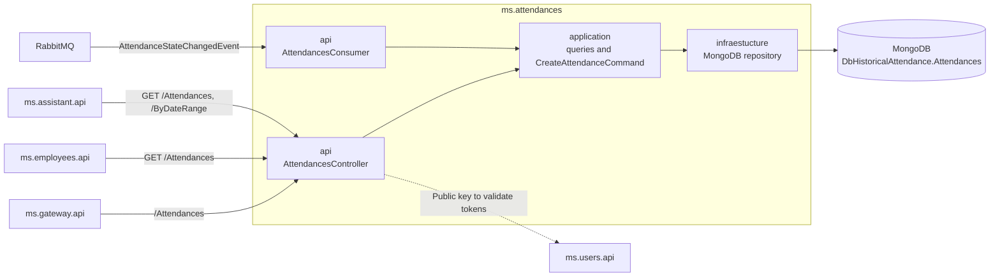

# ms.attendances

Attendance history service. Exposes queries and creation of attendances and persists the records in MongoDB.

## Responsibility

The solution is split into four projects:

- `ms.attendances.api`: HTTP API, JWT validation, Swagger, and RabbitMQ consumer.
- `ms.attendances.application`: commands, queries, handlers, and DTOs.
- `ms.attendances.domain`: `AttendanceRecord` entity and repository contract.
- `ms.attendances.infraestucture`: context, mappings, and MongoDB repository.



## API

In development it is exposed at `http://localhost:9020`.

| Method | Route | Authorization | Function |
| ------ | ----- | ------------- | -------- |
| `GET`  | `/Attendances?userName={userName}` | JWT | Returns the full attendance history of an employee. |
| `GET`  | `/Attendances/ByDateRange?userName={userName}&from={yyyy-MM-dd}&to={yyyy-MM-dd}` | `admin` | Returns an employee's attendances between two dates: both days inclusive, at most 31 days, most recent first. Returns `[]` when there are none; invalid input → `400`. |
| `POST` | `/Attendances` | JWT | Records an attendance for the authenticated user. |

`POST /Attendances` obtains the username from the `NameIdentifier` claim and receives a `CreateAttendanceRequest` with the attendance data. The history is append-only: there are no update or delete endpoints.

### Consumers of this API

- `ms.employees` (Refit) calls `GET /Attendances?userName=`.
- `ms.assistant` (Refit, with the caller's JWT) calls `GET /Attendances?userName=` (tool `get_my_attendances`) and `GET /Attendances/ByDateRange` (tool `get_attendances_by_date_range`, admin). The 31-day limit is duplicated in `GetAttendancesByDateRangeTool.MaxRangeDays`.

Changing these routes or their responses breaks those clients.

## MongoDB

The Docker connection is configured as follows:

```text
MongoDB: mongodb://ms.mongo.attendances.db:27017
Database: DbHistoricalAttendance
Collection: Attendances
```

The service uses `MongoDB.Driver`. The collection is obtained from configuration (bound via the `IOptions` pattern in `AttendanceMongoContext`), and the data is kept in the `mongodb_data` Docker volume.

## RabbitMQ

If the broker isn't accepting connections when the service starts, the consumer keeps trying and logs each failed attempt, and then receives the messages that were waiting (see [`ms.communications`](../ms.communications/README.md)).

`AttendancesConsumer` consumes the `AttendanceStateChangedEvent` queue from `ms.rabbitmq.bus`.

When `ms.employees.api` changes the attendance state, it publishes that event. The consumer transforms it into a `CreateAttendanceCommand` and saves the record in MongoDB.

## Security

All attendance endpoints require a valid JWT issued by `ms.users`. The service only validates tokens: it downloads `ms.users`' public key from `Authentication:JWT:Authority` (in Docker `http://ms.users.api:80`), accepts RS256 only, and holds nothing that could issue a token.

## Dependencies

- .NET `10.0` and ASP.NET Core.
- MediatR and AutoMapper.
- JWT Bearer to protect the endpoints.
- MongoDB.Driver for persistence.
- RabbitMQ.Client via `ms.communications/ms.rabbitmq`.
- Swashbuckle for Swagger.

Package versions are managed centrally via `Directory.Packages.props` at the repository root (NuGet Central Package Management).

## Tests

The `ms-attendances.test` folder contains xUnit test projects, one per layer:

- `ms-attendances.api.test`
- `ms.attendances.application.test`
- `ms.attendances.infraestucture.test`

They use `xunit`, `Moq`, and `coverlet.collector`. Run them from the repository root, one project at a time (the service folder has no project or solution file, so `dotnet test ms.attendances` fails):

```powershell
dotnet test ms.attendances/ms-attendances.test/ms-attendances.api.test
dotnet test ms.attendances/ms-attendances.test/ms.attendances.application.test
dotnet test ms.attendances/ms-attendances.test/ms.attendances.infraestucture.test
```

Or run the whole solution with `dotnet test EmployeeAttendanceControl.sln`.

## Running

```powershell
docker compose up -d --build ms.mongo.attendances.db ms.rabbitmq.bus ms.cassandra.db ms.users.api ms.attendances.api
docker compose logs -f ms.attendances.api
```
