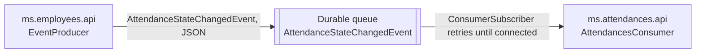

# ms.communications

Shared communication library between microservices. It currently contains the RabbitMQ events and transport implementation.

## Structure

The main project is `ms.rabbitmq` and is organized into:

- `Events`: `IRabbitMqEvent` and `EventBase` contracts for serializable events.
- `Producers`: `IProducer` and `EventProducer` for publishing messages.
- `Consumers`: `IConsumer`, subscription and cancellation contract, and `ConsumerSubscriber`, which subscribes it and tries again until the broker accepts connections.
- `Middlewares`: `UseRabbitConsumer`, which connects the ASP.NET Core lifecycle to `Subscribe` and `Unsubscribe`.

## Communication model

The implementation uses RabbitMQ queues directly, without custom exchanges:

1. The producer gets the event type's name, e.g. `AttendanceStateChangedEvent`.
2. It declares a durable queue with that name.
3. It serializes the event as JSON.
4. It publishes to the default exchange (`""`) using the queue as the routing key.
5. The consumer declares the same queue and consumes its messages.



Events never carry passwords or tokens.

A service that starts before the broker doesn't lose its subscription: `UseRabbitConsumer` tries every 5 seconds, logs each failed attempt as a warning, and stops trying when the application stops. Once connected, `RabbitMQ.Client`'s automatic recovery handles later broker restarts. Tests are in `ms.communications.test/ms.rabbitmq.test`.

RabbitMQ runs in Docker as `ms.rabbitmq.bus`, with AMQP on port `5672` and the management UI at `http://localhost:15672`.

## Events used

### `AttendanceStateChangedEvent`

Published by `ms.employees` and consumed by `ms.attendances`. Used to record the attendance change in MongoDB.

## Dependencies

The `ms.rabbitmq` project uses:

- .NET `10.0`.
- `RabbitMQ.Client`.
- `Microsoft.Extensions.Configuration` to obtain the hostname.
- `Microsoft.Extensions.Hosting` to integrate with the API lifecycle.
- `Microsoft.AspNetCore.Http.Abstractions` for the middleware.

Package versions are managed centrally via `Directory.Packages.props` at the repository root (NuGet Central Package Management).

It is not a standalone API and does not have its own container. It is referenced as a project from `ms.employees` and `ms.attendances`. `EmployeeCreateEvent` was removed: it carried the new employee's password in plain text, and `ms.employees` now creates the account with a direct call to `ms.users`.

## Configuration

Each consuming or producing service must define:

```json
{
  "Communication": {
    "EventBus": {
      "HostName": "ms.rabbitmq.bus"
    }
  }
}
```

This setting is bound via the `IOptions` pattern (`CommunicationConfigExtension`) in the consuming services. When running locally outside of Docker, the hostname can be `localhost`, as long as RabbitMQ is published on the machine.
