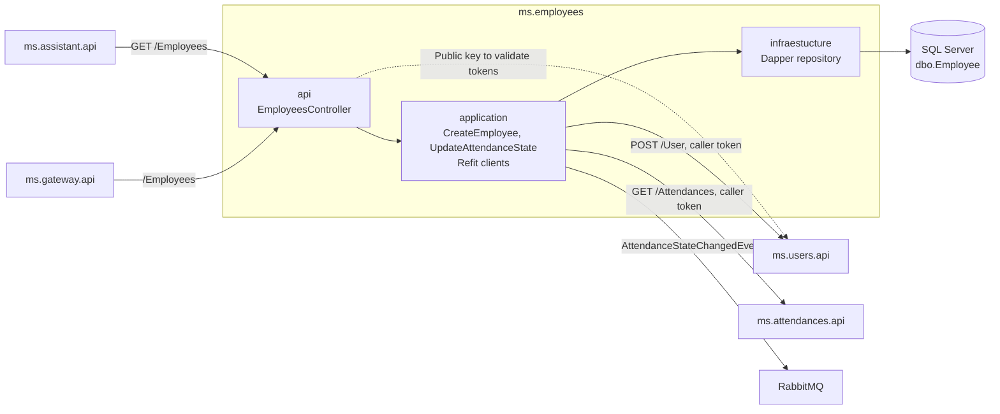
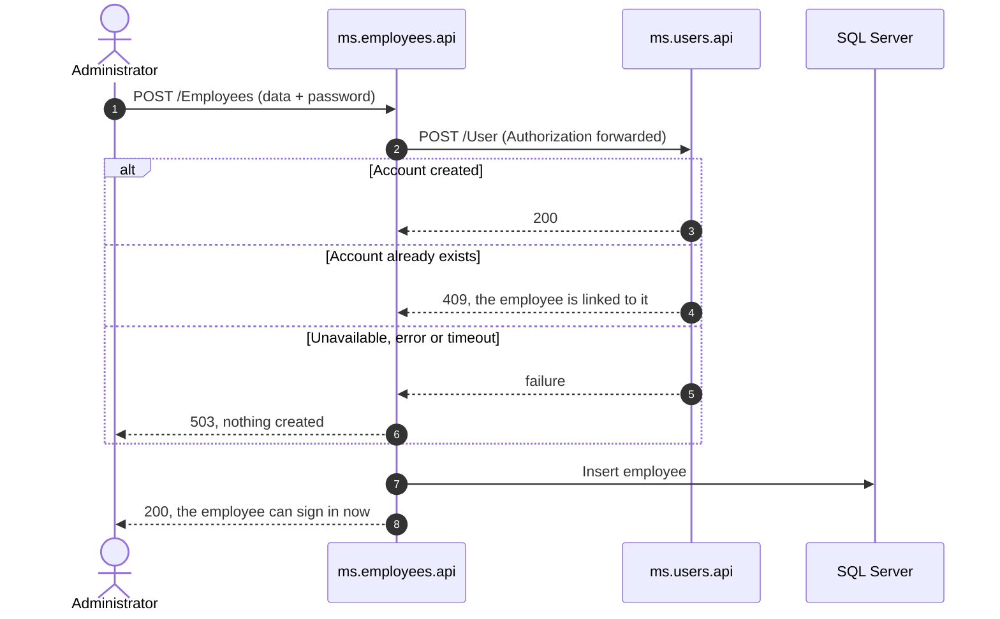

# ms.employees

Employee service. Keeps employment information in SQL Server, exposes administrative operations, and coordinates attendance state with the users and attendances services.

## Responsibility

The solution is split into four projects:

- `ms.employees.api`: HTTP API, JWT validation, Swagger, DI, and the `503` exception handler.
- `ms.employees.application`: commands, queries, MediatR handlers, events, and the Refit clients to `ms.users` and `ms.attendances`.
- `ms.employees.domain`: `Employee` entity, repository contracts, and `UsersServiceUnavailableException`.
- `ms.employees.infraestucture`: Dapper context and SQL Server queries.



## API

In development it is exposed at `http://localhost:9010`.

| Method | Route | Authorization | Function |
| ------ | ----- | ------------- | -------- |
| `GET`  | `/Employees` | `admin` | Returns all employees with their current attendance state. |
| `POST` | `/Employees` | `admin` | Creates the employee's account in `ms.users`, then the employee. `400` missing data, `503` if `ms.users` is unavailable. |
| `PUT`  | `/Employees/AttendanceState/{attendance}` | JWT | Updates the attendance state of the authenticated user. |

`POST /Employees` receives `UserName`, `FirstName`, `LastName`, `Password`, and `Role`. `PUT /Employees/AttendanceState/{attendance}` receives the notes in the body and obtains the user from the `NameIdentifier` claim of the JWT.

## SQL Server

The API uses Dapper and `System.Data.SqlClient`. In Docker, the connection points to `ms.sql.employees.db:1433`, with the `EmployeesAttendance` database and the `sa` user. The connection string is bound via the `IOptions` pattern (`EmployeesDapperContext`).

The `initsqldatabase.sql` file, run by the custom SQL Server image, creates the database, the `dbo.Employee` table, and the initial record. The files are kept in the `sqlserver_data` Docker volume.

## Communication with other services

### Refit towards ms.attendances

When updating attendance, the handler calls:

```text
GET http://ms.attendances.api:80/Attendances?userName={userName}
```

It uses the `Authorization` header received in the request. The number of attendances is included in the notes saved in SQL Server.

### Consumers of this API

`ms.assistant` (Refit, with the caller's JWT) calls `GET /Employees` (tool `list_employees`, admin only) to answer questions about the staff's current attendance state. Changing this route or `EmployeeResponse` breaks the assistant.

### Creating an employee's account



`POST /Employees` first calls `ms.users` directly (`POST /User`, Refit client `IUsersApiCommunication`, `Communication:External:UsersApiUrl`), forwarding the administrator's `Authorization` header, and then saves the employee. The employee can sign in as soon as the call returns.

- The password only passes through: it isn't stored in SQL Server, logged, or published to RabbitMQ.
- If `ms.users` is unavailable or fails (10-second timeout), the answer is `503` and no employee is created.
- If an account with that user name already exists (`409`), the employee is created and linked to it, the existing password stays, and a warning is logged. This lets the administrator retry when the employee failed to save after its account was created.
- `UserName`, `Password` and `Role` are required (`400` otherwise).

### RabbitMQ events

- Publishes `AttendanceStateChangedEvent` when the attendance state is updated. `ms.attendances.api` consumes this event to record the attendance in MongoDB.

The RabbitMQ host is configured via `Communication:EventBus:HostName`; in Docker it is `ms.rabbitmq.bus`.

## Security

`GET` and `POST /Employees` require the `admin` role; `PUT /Employees/AttendanceState/{attendance}` any signed-in user. The service only validates tokens: it downloads `ms.users`' public key from `Authentication:JWT:Authority` (in Docker `http://ms.users.api:80`), accepts RS256 only, and holds nothing that could issue a token. It forwards the caller's own token to `ms.users` and `ms.attendances`.

## Dependencies

- .NET `10.0` and ASP.NET Core.
- MediatR, AutoMapper, and JWT Bearer.
- Dapper and `System.Data.SqlClient` for SQL Server.
- Refit for the HTTP calls to `ms.attendances.api` and `ms.users.api`.
- RabbitMQ.Client via `ms.communications/ms.rabbitmq`.
- Swashbuckle for Swagger.

Package versions are managed centrally via `Directory.Packages.props` at the repository root (NuGet Central Package Management).

## Tests

The `ms.employees.test` folder contains xUnit test projects, one per layer:

- `ms.employees.api.test`
- `ms.employees.application.test`
- `ms.employees.infraestucture.test`

They use `xunit`, `Moq`, and `coverlet.collector`. Run them from the repository root, one project at a time (the service folder has no project or solution file, so `dotnet test ms.employees` fails):

```powershell
dotnet test ms.employees/ms.employees.test/ms.employees.api.test
dotnet test ms.employees/ms.employees.test/ms.employees.application.test
dotnet test ms.employees/ms.employees.test/ms.employees.infraestucture.test
```

Or run the whole solution with `dotnet test EmployeeAttendanceControl.sln`.

## Running

```powershell
docker compose up -d --build ms.sql.employees.db ms.rabbitmq.bus ms.cassandra.db ms.users.api ms.attendances.api ms.employees.api
docker compose logs -f ms.employees.api
```
