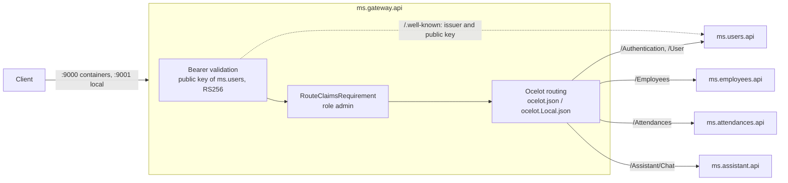

# ms.gateway

API gateway of the attendance control system, built on Ocelot. It is the single entry point for clients.

## Responsibility

`ms.gateway.api` forwards each request to the service that handles it, after checking the token and, for admin-only operations, the `admin` role. It has only an api layer: no application, domain, infrastructure or persistence.

- `Program.cs`: loads the routes, configures token validation and Ocelot.
- `Extensions/`: `AddOcelotRoutes` (chooses the routes file) and `AddGatewayAuthentication` (token validation).
- `ocelot.json` (containers) and `ocelot.Local.json` (gateway on the host): the routes, in the same order.



## API

The gateway exposes the same routes as the services, so a client only changes the host and port. The route table, with the access rule of each one, is in the [root README](../README.md#gateway-routes). Three routes are anonymous: `POST /Authentication`, `POST /Authentication/Refresh` and `POST /Authentication/Logout`. The others require a token, and five of them the `admin` role.

| Response | When |
| -------- | ---- |
| `401` | No token, or a token that is invalid, expired, altered, not signed by `ms.users`, or signed with a replaced key |
| `403` | Valid token without the `admin` role on an admin route |
| `404` | Any other route or method |
| `502` / `503` | Service unreachable / timeout |

Every other response comes from the service unchanged. The services validate the token again, so they stay protected when called directly.

## Security

- **It can't issue tokens.** It holds no key or secret: it downloads `ms.users`' public key through OpenID discovery (`Authentication:JWT:Authority`) on the first token, and caches it.
- **Validation:** RS256 only, issuer `ms.users`, expiry with no clock skew. Short claim names are kept (`MapInboundClaims = false`), so `RouteClaimsRequirement` reads `role`.
- **Key changes:** a token with an unknown key id makes it download the keys again, at most every 30 seconds. Previous keys aren't reused, so tokens signed with a replaced key are rejected at once.
- **`ms.users` down:** tokens keep being accepted with the cached key. If the gateway has no key yet, tokens are rejected with `401`, and it recovers on its own when `ms.users` returns.

## Configuration

| Key | Default | Description |
| --- | ------- | ----------- |
| `Authentication:JWT:Authority` | `http://localhost:9009` | URL of `ms.users`. In Docker: `http://ms.users.api:80`. |
| `ASPNETCORE_ENVIRONMENT` | — | `Local` loads `ocelot.Local.json`; any other value loads `ocelot.json`. |

A new or changed endpoint must be added to **both** routes files in the same order, with `AuthenticationOptions` `Bearer` unless anonymous and `RouteClaimsRequirement { "role": "admin" }` for admin-only routes. It also goes in `e2e/EmployeeAttendanceControl.e2e.test/Catalog/GatewayRoutes.cs`.

## Dependencies

- .NET `10.0` and ASP.NET Core.
- Ocelot.
- JWT Bearer for token validation.

Package versions are managed centrally via `Directory.Packages.props` at the repository root (NuGet Central Package Management).

## Tests

`ms.gateway.test/ms.gateway.api.test`:

- `Configuration/OcelotRoutesTests`: the routes match the catalog, both files have the same routes, and each route has the right access rule.
- `Extensions/ExtensionsTests`: choice of the routes file, and token validation (authority, RS256 only, issuer, expiry, key refresh, no reuse of replaced keys, `401` instead of `500` when the keys can't be downloaded).

```powershell
dotnet test ms.gateway/ms.gateway.test/ms.gateway.api.test
```

The end-to-end checks in [`e2e/`](../e2e/README.md) call every route through the gateway.

## Running

```powershell
docker compose up -d --build                                            # all services, gateway at http://localhost:9000
dotnet run --project ms.gateway/ms.gateway.api --environment Local      # gateway on the host at http://localhost:9001
```

The design is in `features/001-ocelot-api-gateway/`.
