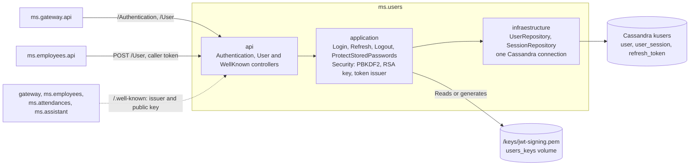
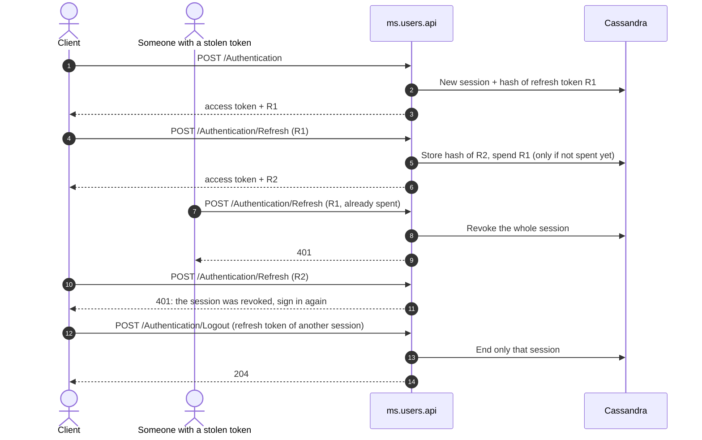

# ms.users

User and authentication service for the attendance control system.

## Responsibility

`ms.users` manages the accounts that can authenticate, and their sessions. It is the **only** service that issues tokens: it signs them with an RSA private key that no other service has, and publishes the public key so that the gateway and the services can check tokens without being able to create them. It also allows querying users and creating new accounts for administrative operations.

The solution is split into four projects:

- `ms.users.api`: HTTP API, JWT validation, publication of the public key, Swagger.
- `ms.users.application`: commands, queries, MediatR handlers, DTOs, mappings, and `Security/` (password hashing, signing key, token issuing).
- `ms.users.domain`: `User`, `UserSession` and `RefreshToken` entities, repository interfaces, and exceptions.
- `ms.users.infraestructure`: Cassandra connection and repositories.



## API

The API is exposed in the container on port `80` and, in development, at `http://localhost:9009`.

| Method | Route | Authorization | Function |
| ------ | ----- | ------------- | -------- |
| `POST` | `/Authentication` | Public | Validates the username and password, starts a session, and returns `{ accessToken, refreshToken, expiresIn }`. 401 for any invalid data, 503 if the data can't be reached. |
| `POST` | `/Authentication/Refresh` | Public | Exchanges a refresh token for a new pair. 401 for any rejected token. |
| `POST` | `/Authentication/Logout` | Public | Ends the session of the refresh token. 204, also for an unknown token; 400 without a token. |
| `GET` | `/User` | `admin` | Returns all users, as `{ userName, role }`. Passwords are never returned. |
| `POST` | `/User` | `admin` | Creates an account with `UserName`, `Password`, and `Role`. 409 if it already exists. |
| `GET` | `/.well-known/openid-configuration` | Public | Issuer and URL of the public key. Used by services, not routed through the gateway. |
| `GET` | `/.well-known/jwks.json` | Public | Public key that verifies tokens (JWKS). |

Refresh and logout are public because the refresh token is itself the proof, and an expired access token mustn't prevent them.

### Consumers of this API

- `ms.employees` calls `POST /User` directly, forwarding the administrator's token, to create the account of a new employee.
- The gateway, `ms.employees`, `ms.attendances` and `ms.assistant` download `/.well-known/*` to validate tokens.

## Tokens and sessions

- **Access token:** JWT signed with RS256, valid for 15 minutes (`Authentication:JWT:AccessTokenMinutes`). Claims: user name (`nameid`), role (`role`) and issuer (`ms.users`).
- **Refresh token:** 256 random bits, single use. Only its SHA-256 is stored. Using one returns a new pair and spends it.
- **Reuse:** presenting a spent refresh token revokes its whole session, including the newest token, and logs a warning. Other sessions are unaffected. There's no tolerance window: a client that retries a renewal whose response it lost has to sign in again.
- **Sessions:** several per person. A session ends after 7 days without renewal and in any case 30 days after sign-in (`Authentication:Session`). Signing out ends only the current session; the access token already issued keeps working until it expires.
- **Signing key:** read from `Authentication:JWT:PrivateKeyPath`, or generated and saved there on first start when the file is missing. In Docker it lives in the `users_keys` volume (`/keys/jwt-signing.pem`). It is never in the repository. In production, provide the file from a secret store, shared by every instance.
- **Changing the key:** replace or delete the file and restart `ms.users`. The other services pick up the new public key on the first token they don't recognize, at most every 30 seconds, without restarting. Tokens signed with the old key are rejected, so clients renew or sign in again.



## Passwords

- Stored only as PBKDF2-HMAC-SHA256 with 600,000 iterations and a random salt per password, in the format `pbkdf2-sha256$iterations$salt$hash`. Two accounts with the same password have different values, and the stored value doesn't work as a password.
- On startup, the service converts any readable password still stored, and only then accepts requests. Each account is updated only if its value didn't change meanwhile, so restarting is harmless. If the conversion fails, the service stops, logs the failure without any value, and the restart policy tries again.
- Passwords are never returned, logged, or sent through RabbitMQ.

## Cassandra

The configuration is found under `DatabaseSettings` and bound via the `IOptions` pattern (`CassandraCluster`, `UsersContext`):

```json
{
  "Hostname": "ms.cassandra.db",
  "Keyspace": "kusers",
  "Port": "9042"
}
```

The service keeps a single connection to Cassandra, opened on first use. If Cassandra is down, requests get a 503 and the next one tries to connect again, so the service recovers on its own.

The custom Cassandra image runs `cassandra/init.cql` on every start. The script idempotently creates the `kusers` keyspace and the tables below, removes the unused `kusers."User"` table of older versions, and seeds the `admin` user (password `1234`, role `admin`) already protected.

| Table | Content |
| ----- | ------- |
| `user` | `user_username`, `user_pasword` (protected form), `user_role` |
| `user_session` | `session_id`, `session_username`, `session_created_at`, `session_last_renewed_at`, `session_ended_at`, `session_end_reason` |
| `refresh_token` | `token_hash` (SHA-256), `token_session_id`, `token_spent_at` |

Sessions and refresh tokens are written with a time to live, so they disappear on their own after the session's absolute limit.

## Upgrading an existing installation

This version stops consuming RabbitMQ. Before deploying it, check that the `EmployeeCreateEvent` queue is empty, and then delete it: a waiting message holds a readable password and nothing would process it any more. If one was waiting, create that account by hand with `POST /User`.

```powershell
docker exec ms.rabbitmq.bus rabbitmqctl list_queues name messages
docker exec ms.rabbitmq.bus rabbitmqctl delete_queue EmployeeCreateEvent
```

Everyone signs in again once, because tokens signed with the old shared key are no longer accepted. Dropping `kusers."User"` may leave a copy in a Cassandra snapshot (`nodetool listsnapshots`); remove it with `nodetool clearsnapshot` when you no longer need it.

## Dependencies

- .NET `10.0` and ASP.NET Core.
- MediatR for commands and queries.
- AutoMapper for mappings.
- JWT Bearer and `System.IdentityModel.Tokens.Jwt` for issuing and validating tokens.
- `CassandraCSharpDriver` and `Cassandra.Mapping` for persistence.
- Swashbuckle for Swagger.
- `ms.users.application`, `ms.users.infraestructure`, and `ms.users.domain`.

Package versions are managed centrally via `Directory.Packages.props` at the repository root (NuGet Central Package Management).

## Tests

The `ms.users.test` folder contains xUnit test projects, one per layer:

- `ms.users.api.test`
- `ms.users.application.test`
- `ms.users.infraestructure.test`

They use `xunit`, `Moq`, and `coverlet.collector`. Run them from the repository root, one project at a time (the service folder has no project or solution file, so `dotnet test ms.users` fails):

```powershell
dotnet test ms.users/ms.users.test/ms.users.api.test
dotnet test ms.users/ms.users.test/ms.users.application.test
dotnet test ms.users/ms.users.test/ms.users.infraestructure.test
```

Or run the whole solution with `dotnet test EmployeeAttendanceControl.sln`. Sessions, signing and passwords are also checked end to end in [`e2e/`](../e2e/README.md).

## Running

```powershell
docker compose up -d --build ms.cassandra.db ms.users.api
docker compose logs -f ms.users.api
```
